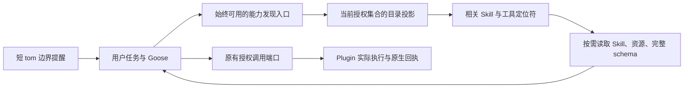

# Anchor 大规模 Plugin 渐进式披露研究

研究日期：2026-10-13。Anchor 对照版本：`dba4d725bc40afff50b30ccc1018b48b027ad2f0`。

行业已有可借鉴的方案：**保留少量稳定入口，在完整的授权能力集合中发现相关项，再按需读取 Skill 指令、资源和工具参数 schema。** 这能让初始上下文和新增披露量受预算控制，同时保持能力可达。各产品的具体协议、目录预算和执行边界不同，不能直接把某个开关当作 Anchor 已完成接入。

需要修正此前“用 tom 承载 Plugin 短目录”的建议：少量条目可以在预算内展示；数量很大时，tom 只放发现入口及当前边界提醒。即使每条只是名称和一句描述，全量目录也随数量增长。tom 不能作为唯一发现入口。

本报告是研究和建议，没有实施 Runtime 改造、变更服务配置或更新部署；没有新增真实 Provider 验收。不是已冻结的架构决定，也不改变开发台账中的完成状态。

## 1. 分清三种成本

| 对象 | 需要披露的内容 | 可延迟的部分 | 仍存在的成本 |
| --- | --- | --- | --- |
| Plugin / Skill | 用途、适用条件、稳定定位符 | 选中 Skill 的正文及关联文件 | 宿主目录扫描、元数据解析、检索 |
| MCP 工具 | 工具用途及完整参数约束 | 与任务无关的完整 schema | 宿主取得 inventory、建立索引 |
| MCP server | 连接、认证、进程、实际可用性 | 在有合法发现依据时按需连接 | 生命周期、凭据、失效及取消处理 |

Skill 正文按需读取不代表工具 schema 已按需加载；schema 没进入初始模型请求也不代表 MCP 进程尚未启动。MCP 的 `tools/list` 分页只是协议分页，客户端仍可以读完所有页并把所有 schema 发给模型。[M1]

## 2. 第一方实现对比

| 实现与证据范围 | Skill 指令披露 | 工具披露 | 大规模边界 |
| --- | --- | --- | --- |
| Goose v1.53.0 源码；另核对当前官方文档和固定上游 commit | 全量名称/描述 → `load_skill` 正文 → supporting files | 可选 Code Mode：函数目录/虚拟文件 → 详情 → 调用 | 原生 Skill 目录和默认函数目录仍平铺；Anchor lean 未编译 Code Mode |
| Codex 正式 `rust-v0.162.1` 源码；main 另固定 SHA | 元数据有预算，选中后读正文和关联文件 | 客户端 BM25 → 原生 Responses `tool_search_output`，携带完整 schema | 超额 Skill 会省略；工具搜索要求模型支持协议；不能默认迁移到普通兼容 Provider |
| Claude Code 当前官方文档；Anthropic 工程文章 | 名称/描述 → Skill 全文 → 关联资源 | Tool Search → 工具引用 → 完整 definitions | 名称表仍随数量增长；搜索依赖模型及部署；连接缓存是另一项机制 |

共同的设计是分层发现和读取，不是把所有内容压成更短的每轮提示。它们也没有证明任何描述、任何语言、任意多 Plugin 都能获得百分之百召回和任务成功。

### Goose：可复用的基础与真实限制

Goose 把 tom、Skills、Code Mode 和 Extension Manager 分成不同职责。[G1] [G2] [G3]

- **tom / MOIM**：每个文本或文件来源最多 65,536 bytes；被识别的模型窗口小于 32,000 token 时跳过 MOIM。它在一个 Goose 回复 Turn 开始时合成并持久化，旧块留在原生历史；不是每个模型请求都追加，也不是免费的常驻目录。源码和压缩规则专门处理最新 Turn context。[G4] [G8] [G9]
- **Skills**：启动时把发现的所有 Skill 名称、描述加入指令；`load_skill(name)` 读正文，`load_skill(name/path)` 读 supporting file。固定版没有全局目录预算、query 或 cursor。宿主发现时仍读取文件并解析内容，不是完全延迟磁盘 IO。[G5]
- **目录适配**：原生发现扫描工作区/用户的 `.agents/skills`、`.goose/skills`、`.claude/skills` 和 Goose Plugin roots，不直接扫描 Anchor 的 `/plugins/<id>`。未找到 ACP new/load 的每 Session 授权 Skill roots 接口；`additional_source_roots` 用于 sources 管理，不接入 `load_skill` 的发现过程。[G5]
- **Plugin 状态适配**：直接映射 Goose Plugin 生态还会引入其 enabled 配置、安装更新及名称改写。Anchor 当前传入 `_meta.enabledExtensions`，因此固定 ACP 的初始化不会走 Plugin MCP 自动发现分支；不能写成“放入目录就必然启动未授权 MCP”。仍需确保目录是 Anchor 授权事实的只读投影，而不是第二套 Plugin 管理状态。
- **Code Mode**：固定版 catalog 模式提供 `list_functions`、`get_function_details`、`execute_typescript`，降低初始 schema 成本；但 `list_functions` 无查询或分页。filesystem 模式允许搜索/读取 PCTX 的虚拟工具文件；sidecar 模式明确保留全部工具，不做渐进搜索。完整宿主 inventory 仍会收集，server 不因此懒连接。[G6]
- **接入风险**：Code Mode 回调继续经 Goose ExtensionManager 调用 MCP，但结果转换只保留 assistant-visible Text，忽略媒体、structuredContent 和 `_meta`，且该转换不读取 `is_error`。必须验证 Anchor 的失败、业务工具身份、原生问题、取消和 trace。不能只凭“支持 MCP”签认完整语义兼容。[G6]
- **发行限制**：Anchor 构建仅启用 `rustls-tls,online-model-meta`，没有 `code-mode` feature。后者引入 PCTX/Deno 路径；静态 musl 发行、体积、命名及资源消耗需要实际构建验证。
- **Extension Manager**：控制整个 Goose extension。Anchor 是单一聚合 MCP `anchor`，管理器无法按其中的 Plugin 挂载或授权；不能用 Goose enable 状态取代 Host 的权限事实。官方建议 5 个以内 active extensions、总共 50 个以内 tools，是性能建议而非硬上限。[G3]

核对的当前上游 commit 为 `69de89c50cc01d4e0187d6645bf3618729873f74`。Skills 发现逻辑与固定版相同；Code Mode 主要变成 ExtensionLease 接线，没有自动补齐 Anchor 根适配、catalog 查询和完整回执。[G7]

### Codex：借鉴语义，区分原生协议

正式 release 源码把 Skill 元数据预算设为已知窗口的 2%；窗口未知回退 8,000 字符。先缩短描述，连名称和定位符都放不下时省略条目。Executor/Cloud 来源仍可通过分页 `skills.list` 和 `skills.read` 找到、读取已启用的省略项；未建立 host 文件 Skills 同样具有统一搜索兜底的证据。便宜 Skill 选择器明确运行在 shadow 中，不改变模型可见目录。[O1] [O5] [O6] [O7]

工具搜索则查询宿主的 deferred registry。正式 release 用本地 English BM25，把匹配的完整 namespace/function spec、描述和参数作为 **Responses 原生 `tool_search_output`** 返回，下一次模型请求可发正常函数调用。这不是只返回名字的普通文本结果，也不是 Anthropic 的 `tool_reference`。普通 MCP 的 deferred/direct 取决于 `model_info.supports_search_tool`，不能假设 Anchor 的固定 Goose 和任意 OpenAI-compatible Provider 支持同一 wire format。[O2]

还存在规模边界：默认工具来源短目录的 aggregate cap 为 512 KiB；agent-plugin 的单工具/合计 schema 有隐藏上限。默认关闭的实验 `DeferredToolWorldState` 才有另一套更小的 namespace 投影，不能当作已默认部署能力。主干压缩逻辑可能清空历史搜索输出的 schema，支持再次搜索才是正确前提。[O3] [O4] [O8] [O9]

OpenAI 官方 Skills / Tool Search 网页实际返回 403，因此这里的结论是**第一方公开 release 源码事实**，不是所有远端产品、账号、模型的开放状态。release tag 内容已取得，peeled commit 查询超时；main SHA `12cca49c81c8aa6a37a5cc4e39964ee3b70f9458` 不冒充 release SHA。

### Claude：预算、检索、连接和压缩分别处理

Claude Code 当前文档说明 Skill 目录预算按窗口 1% 缩放，保留所有名称，超额从低使用频率条目开始丢描述。名称仍有 O(N) 成本；丢失描述会减少匹配关键词，官方明确承认会导致不触发。标准中约 100 token 的元数据只是示例；1,000 条按该示例计算已约 100,000 token，不是可无限扩展的承诺。[C1] [S1]

当前 Tool Search 未设置环境变量时默认 deferred；`ENABLE_TOOL_SEARCH=auto` 才是 schema 达窗口 10% 时切换的阈值模式。搜索匹配后加载完整 definitions，可让少量高频工具常驻；要求支持 `tool_reference` 的模型，非第一方代理及部分托管部署会回退或拒绝，不能直接套到 Anchor 的所有 Provider。[C2] [C3]

HTTP/SSE MCP 另有发现缓存与首次调用连接，需 v2.1.221+。当前文档说明缓存默认关闭，除非账号 rollout 已启用或显式配置；不能说所有 Claude Code 用户默认懒连接。缓存是前次发现观察，不是授权。[C2]

Skill 正文可跨 Turn 留在历史，但压缩只保留有限的最近内容，必要时再次调用。曾读取指令不等于当前拥有权限。Code execution with MCP 则把工具定义变成按需浏览的 API 文件，中间数据留在执行环境，是另一项可选优化。[C1] [C4]

Anthropic 的 85% token 减少，以及代码执行示例 150,000→2,000 token，均属厂商特定测量；本研究没有复现，更不能算作 Anchor 收益。[C3] [C4]

## 3. Anchor 当前的缺口

以下是当前代码事实，不是目标架构已完成的声明。

| 当前位置 | 已有能力 | 仍缺什么 |
| --- | --- | --- |
| `rust/anchor-runner-host/src/tool_disclosure.rs:52` | Node 的可选披露包装器；`anchor_tools` 搜索/分页，`anchor_tools_call` 转给原端口 | 搜索只有 name、160 字符摘要及 read_only，没有完整 input schema；仅 substring 检索；默认 50、最大 200 项，缺输出字节总预算 |
| `rust/anchor-runner-host/src/node_host.rs:1003` | Node 装配已接包装器 | 本次只读核查 PID 184037 的 `ANCHOR_NODE_TOOL_DISCLOSURE=0`，当前部署关闭它；这不等于包装器不存在 |
| `rust/anchor-runner-host/src/goose_acp/pilot.rs:434` | Pilot 合并内置与本 Turn 准备的 Plugin 工具 | 未共用 Node 的披露包装；Pilot 原生确认/问题仍有专门调用路径 |
| `rust/anchor-graph-host/src/lib.rs:209` | Plugin 有 name、description 和 Skill 路径 | 没有统一的逐 Skill 名称、用途、适用条件视图；路径列表不能代替 Skill 发现 |
| `rust/anchor-runner-host/src/pilot_tools/plugins.rs:65` | `plugin_list` 列 Library；`plugin_read` 读内容 | list 无分页；read 有 instructions.md 就读它，否则读全部 Skills；指定 resource 仍附带上述整份指令，难以控制按需披露 |
| `rust/anchor-runner-host/src/goose_acp.rs:700`、`node_tools.rs:369` | Node 提示列 Skill/指令路径，`anchor_read` 读取 workspace | `anchor_read` 不能直接读 `/plugins`；目前可经授权 shell 读取。发现结果必须给实际可用的读取入口 |
| `rust/anchor-runner-host/src/tool_host.rs:384` | 准备正式工具时校验并连接授权 servers | 仍逐一连接，不会因为隐藏 schema 自动减少冷启动进程/网络成本 |

已有正确基础也应保留：`plugin_view.rs` 在同一短 Library lease 内读取一份定义，派生 bindings、MCP、挂载和依赖视图，释放后才做网络启动；`plugin_mounts.rs` 管理 Turn/调用的挂载授权；`goose_acp/bridge.rs` 管理观察、原生工具身份、回执、取消和完成验证。

## 4. 建议的接入方式

建议保持 Goose loop、ACP、原生 Session 和 compaction，在现有 Host MCP / ToolPort 边界补齐披露。以下是 Agent 可选择使用的工具关系，**不是新增 Host 强制阶段或自有 Agent loop**。

### 4.1 入口常驻，目录有预算

模型稳定看到发现、读取、调用及必须的工作区/完成/交互工具。Node 的原生完成工具必须保留正确身份与回执验证；Pilot 的原生确认和提问继续走原接入。

少量 Plugin 时可给短摘要；超过预算时只给有限提示、数量/省略说明和查询入口，不全列名称。发现工具的描述和必要基础指令也必须说明怎么使用，避免依赖 tom 在每个模型上出现。

能力还在宿主目录中，只是没有全部进入提示词。新披露量按相关项和输出预算控制；会话累计内容继续交给 Goose 压缩。

### 4.2 发现查询完整授权集合，返回小批次

用 Plugin 元数据、Skill frontmatter/既有说明、已注册工具的名称与描述构建可重建检索视图。没有 frontmatter 的既有 Skill 继续可读、可列，不强制立即改写全部 Plugin。

复用成熟词法检索、精确名称和必要的别名/分词即可作为起点，不先引入向量数据库或模型路由服务。Codex 使用 English BM25 的事实同时提醒我们：中文任务不能直接照搬英文 tokenizer，需覆盖中文分词或字符 ngram、跨语言别名及描述质量。

自然语言搜索给相关候选及实际可用的读取定位符；另外保留精确 Plugin/Skill/Tool 标识查询、按 Plugin 筛选和分页枚举。**这保证预算省略项仍可达，不保证模型永远选中正确能力。** 分页和精确查找是召回失败时的兜底；输出同时有条数与字节预算，显示是否还有结果，不能静默截尾。

Pilot 作为管理者可以查询已安装 Library；当前执行可调用集合则只含已挂载并授权的工具。AgentNode 只看自身授权范围。管理目录的发现不自动安装、挂载或扩大权限；两种可见范围都投影自原事实，不建第二个资产库。

### 4.3 选具体 Skill，只读必要资源

发现返回逐 Skill 的用途和入口，读取返回所选 Skill 的完整指令，关联文件另行按需读。读一个资源不再附带整个 Plugin 的其他 Skills。

可以评估把授权 Skill roots 做只读投影后接 Goose 原生 `load_skill`，但当前固定 ACP 没有直接 roots 注入接口，不能简单启用全局扫描。先沿 Anchor 已有只读资源能力提供 Pilot/Node 一致的读取契约，是当前更小的接入边界；此处应复用路径 confinement，不能把 `/plugins` 伪装成 `anchor_read` 已支持的 workspace 路径。

### 4.4 工具详情必须包含完整 schema

工具摘要用于选择，完整描述、input schema 和必要注解用于正确调用。复杂 required、数组、枚举和嵌套结构不能靠名称猜测，也不能为了预算静默删约束。单个定义过大时明确反馈并提供合法读取方式，不能把被截断的 JSON 声称为完整 schema。

在普通 Provider 上，可用少量普通 MCP 元工具返回完整 schema，再通过已有 `anchor_tools_call` 语义转发执行。它能实现按需学习参数，但**不等于 Codex 原生 schema 加载及参数约束解码**；必须验证实际参数正确率和同一 Agent 的错误修正。支持原生加载的 Provider 将来可以使用适配器，但不应成为基本产品能力的前提。

Pilot/Node 共用发现和详情策略，保留各自实际授权调用适配器。Pilot 的 `start_pilot` 和 `call_mcp` 携带原生 peer/elicitation，不能仅包一个泛化 `ToolPort` 就假设确认和问题自然保留。trace 必须能识别真实业务工具，回执、媒体、失败和取消继续由原路径负责，不能只留下元工具名称。

### 4.5 目录和缓存保持唯一事实来源

授权工具目录由本次已有准备结果派生，不在准备后重新独立扫描 Library 来拼另一份执行事实。索引与缓存只是可重建投影，不拥有 mount、授权或 Plugin 版本；能力/配置变化后失效、重建。

这也不新增历史代码快照：沿用当前架构中授权冻结与代码/依赖观察分离的规则，后续节点调用/Turn 准备按现有合法热更新路径读取。Skill/详情读取必须遵守同一授权边界；旧上下文里的路径、schema 和“曾加载”信息不能放宽当前权限，失效时明确提示重新发现。

压缩、恢复继续由 Goose 负责。Anchor 保持发现/读取入口可重复使用，不维护永久的“已读列表”或另一套记忆、计划、恢复日志。

## 5. 大量挂载时的实际效果与边界

假设有 N 个 Plugin、S 个 Skill、T 个工具：初始模型不需要收到 N/S/T 个条目，只需要稳定入口及预算内提示；一次发现返回有限相关项，正文/schema 只读实际选用项。宿主仍需要元数据与 inventory，索引和准备成本不能宣称消失。历史中已经读过的内容也会积累，仍依赖原生 compaction。

若出现很多远程 MCP 或本地子进程，schema 披露之外需要独立的按需连接切片：必须有可信的发现来源，处理缺凭据、未连接、失败、inventory 更新、首次使用和取消。缓存不代替调用前授权与真实 schema 核查。当前 Anchor 没有这项懒连接，不建议为了先解决上下文而同时重写 MCP 生命周期。

Goose Code Mode 的价值主要在批量调用、把中间数据留在执行环境和减少结果上下文。它可以作为后续可选优化；先实际验证 lean/musl 构建、命名、错误、媒体、elicitation、trace 和取消，再决定启用范围。无需以升级 Goose 或启用 Deno 执行器作为第一切片的前提。

## 6. 后续验收建议

研究尚未实施下列验证。实施时先用小型 fixture 和确定性 Provider 验契约，再用真实 Provider 验发现和任务结果；无真实 Provider 不补签产品闭环。

| 维度 | 必须覆盖的场景 | 应分别记录的证据 |
| --- | --- | --- |
| 规模与预算 | 10/100/1,000 Plugin；另测单 Plugin 大量 Skill/工具；长描述 | 初始 schema/目录字节与 token、每次披露预算、宿主准备耗时和资源 |
| 发现 | 中文/英文/别名、低频能力、末页条目、同名相近能力、跨 Plugin 任务 | 检索命中、精确标识可达、分页无遗漏、实际选用率 |
| 正确调用 | 无参数及复杂嵌套 schema、枚举、必填字段、读写工具 | 所获 schema 是否完整、参数有效率、真实工具执行和最终任务产物 |
| 权限与可用性 | 未挂载、禁止联网、缺凭据、未连接/失败、mount 下一 Turn 生效 | 授权拒绝与不可用原因；发现不改变权限；失败不伪装成空目录 |
| 更新与接续 | Plugin 代码/依赖合法热更新、授权声明变化、取消、重启 | 当前准备事实和执行观察；不以缓存沿用失效权限、不自动重放副作用 |
| 压缩 | 已加载说明经 compaction 后重新搜索/读取、原生 Session 接续 | 入口仍存在、取到当前合法内容、继续完成实际任务 |
| 调用投影 | Pilot 原生确认/问题、Node final_result、媒体、业务失败 | 原生工具身份、授权观察、回执、错误、取消和 UI trace 保持一致 |

不能用“列表更短”“模型看到了名字”替代任务成功验收；也不能把分页可达说成百分之百语义召回。确定性回归复用当前 Host → GraphRunner → NodeExecutionPort → Goose ACP → 授权 MCP 路径，只替换模型传输。

## 7. 证据与访问限制

- Goose 记录：[findings_goose.md](findings_goose.md)。固定版源码与本地源码摘要对照见 `goose_official_source_checks.json`；上游 commit/tree 和差异也已保存。旧 `block.github.io/goose` 地址返回 404，实际取得正文来自当前官方站点。
- Codex 记录：[findings_codex.md](findings_codex.md)。官方网页 403；release tag 关键源码已取得，main 另固定 SHA；未实际运行其测试或 API。
- Claude/标准记录：[findings_claude.md](findings_claude.md)。实际网页正文、URL、最终 URL、获取时间与 SHA256 在 `sources/`。两条 Tool Search API 文档请求虽 HTTP 200，却重定向到区域不可用页，未把它当文档；API 机制来自已取得的官方工程文章。
- Anchor 核查仅阅读代码和指定进程的三个非敏感披露配置。没有运行 Cargo/Web 检查、规模压测、真实模型或业务 Graph；本任务未改业务代码，不需要把只读研究伪装成测试通过。

[G1]: https://goose-docs.ai/docs/guides/context-engineering/using-skills/
[G2]: https://goose-docs.ai/docs/guides/managing-tools/code-mode/
[G3]: https://goose-docs.ai/docs/mcp/extension-manager-mcp/
[G4]: https://github.com/aaif-goose/goose/blob/v1.53.0/crates/goose/src/agents/moim.rs
[G5]: https://github.com/aaif-goose/goose/blob/v1.53.0/crates/goose/src/skills/client.rs
[G6]: https://github.com/aaif-goose/goose/blob/v1.53.0/crates/goose/src/agents/platform_extensions/code_execution.rs
[G7]: https://github.com/aaif-goose/goose/commit/69de89c50cc01d4e0187d6645bf3618729873f74
[G8]: https://github.com/aaif-goose/goose/blob/v1.53.0/crates/goose/src/agents/platform_extensions/tom.rs
[G9]: https://github.com/aaif-goose/goose/blob/v1.53.0/crates/goose/src/context_mgmt/mod.rs
[O1]: https://github.com/openai/codex/blob/rust-v0.162.1/codex-rs/ext/skills/src/render.rs
[O2]: https://github.com/openai/codex/blob/rust-v0.162.1/codex-rs/core/src/tools/handlers/tool_search.rs
[O3]: https://github.com/openai/codex/blob/rust-v0.162.1/codex-rs/features/src/lib.rs
[O4]: https://github.com/openai/codex/blob/12cca49c81c8aa6a37a5cc4e39964ee3b70f9458/codex-rs/core/src/compact_remote_history.rs
[O5]: https://github.com/openai/codex/blob/rust-v0.162.1/codex-rs/ext/skills/src/tools/list.rs
[O6]: https://github.com/openai/codex/blob/rust-v0.162.1/codex-rs/ext/skills/src/tools/read.rs
[O7]: https://github.com/openai/codex/blob/rust-v0.162.1/codex-rs/ext/skills/src/dynamic_skill_selector.rs
[O8]: https://github.com/openai/codex/blob/rust-v0.162.1/codex-rs/core/src/tools/handlers/tool_search_spec.rs
[O9]: https://github.com/openai/codex/blob/rust-v0.162.1/codex-rs/core/src/mcp_tool_exposure.rs
[C1]: https://code.claude.com/docs/en/skills.md
[C2]: https://code.claude.com/docs/en/mcp.md
[C3]: https://www.anthropic.com/engineering/advanced-tool-use
[C4]: https://www.anthropic.com/engineering/code-execution-with-mcp
[S1]: https://agentskills.io/specification.md
[M1]: https://modelcontextprotocol.io/specification/2025-11-25/server/tools.md
